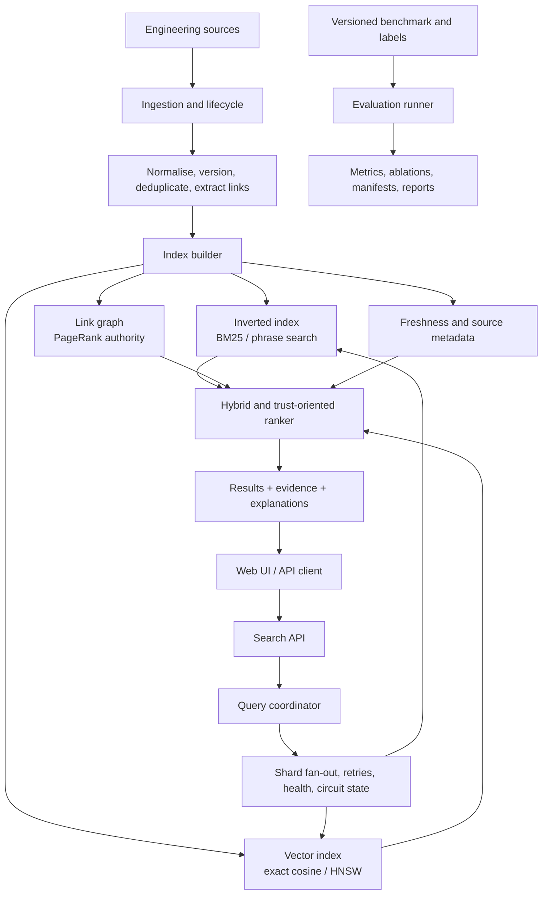

<div align="center">

# NEBULA

### Trust-oriented, explainable hybrid search for engineering knowledge

NEBULA is a research prototype for retrieving engineering documentation with signals that make results easier to inspect: lexical relevance, semantic similarity, freshness, source authority, graph context, evidence, and system health.

[](https://github.com/Bishrav/NEBULA/actions/workflows/validation.yml)
[](https://github.com/Bishrav/NEBULA)
[](benchmarks/evaluation/README.md)
[](https://openjdk.org/)
[](https://www.python.org/)

**[Architecture](docs/architecture/overview.md) · [Research plan](docs/research/research-plan.md) · [Academic brief](docs/research/academic-research-brief.md) | [University review brief](docs/research/tu-darmstadt-submission-brief.md) · [Demo workflow](docs/demo-workflow.md) · [Evaluation](benchmarks/evaluation/README.md)**

</div>

> **Honest status.** NEBULA has a working Java 17 retrieval and reliability prototype, an attributed 843-document research corpus, protected independently created relevance judgements, a frozen BGE configuration, and one measured held-out run. The protected result is preliminary and underpowered; it is not a validated claim about trust, user benefit, statistical superiority, or production-scale search.

## The problem

Engineering knowledge is distributed across READMEs, architecture decisions, runbooks, incident reports, API specifications, and project notes. Keyword search misses meaning. Opaque AI search can return plausible results without showing why they were selected, whether they are current, or what evidence supports them.

NEBULA treats search as both a systems problem and an empirical research problem:

> **Find relevant information, expose the reasons for the ranking, and measure how the system behaves when the evidence or infrastructure is imperfect.**

The project is designed to answer three practical questions:

1. Which retrieval signals improve engineering search quality?
2. Can those signals be exposed as inspectable evidence rather than an unexplained score?
3. How does retrieval quality and availability change under shard, replica, and network failures?

## At a glance

| Dimension | Current scope |
| --- | --- |
| Research area | Information retrieval, trustworthy AI, distributed systems, empirical evaluation |
| Primary question | How do freshness, source-authority, and graph-related signals affect retrieval effectiveness compared with lexical, dense, and conventional hybrid retrieval? |
| Retrieval methods | BM25, phrase search, semantic baselines, exact cosine, custom HNSW, score fusion, RRF |
| Trust-oriented signals | Freshness, source authority, PageRank-style graph authority, evidence metadata |
| Reliability model | Sharding, fan-out, deterministic top-k merge, retries, replicas, circuit breaking, partial-result reporting |
| Current evidence | Reproducible synthetic fixture plus a protected 843-document corpus evaluation with 47 approved queries and an 8-query held-out split |
| Metrics | Precision@k, Recall@k, MRR, NDCG, ANN recall/latency, graph diagnostics, and failure behaviour |
| Reproducibility | Versioned inputs, frozen split, SHA-256 lock file, generated reports, CI validation |
| Academic status | Research prototype with measured protected evidence; broader validation, institutional review, and publication-quality inference remain pending |

## What is implemented

### Retrieval and ranking

- Inverted indexing, TF-IDF, BM25, phrase queries, and deterministic tie-breaking
- Transparent semantic hashing and character n-gram retrieval baselines
- Exact cosine search and a custom HNSW approximate-nearest-neighbour index
- Hybrid lexical-semantic ranking with score normalisation
- Reciprocal Rank Fusion (RRF) as a rank-based hybrid baseline
- Freshness, source-authority, graph/PageRank, and trust-oriented ranking variants
- Evidence-oriented result explanations and machine-readable evaluation reports

### Reliable and distributed search

- Consistent-hash document placement and query fan-out
- Deterministic global top-k merging
- Primary/replica indexing and replica failover
- HTTP shard clients with bounded retries and timeouts
- API-token protected shard traffic
- Endpoint health monitoring, circuit breaking, and explicit partial-result metadata

### Research and reproducibility

- Versioned corpus, query, trust-metadata, and benchmark fixtures
- Frozen development/held-out split for regression experiments
- Experiment manifests containing Git revision, file sizes, and SHA-256 checksums
- Ranking, ANN, graph, and embedding ablation reports
- Annotation validation, agreement analysis, adjudication, and release gates
- GitHub Actions validation, Java tests, Python tooling tests, and Docker builds

## Architecture



A request follows this path:

```text
source
  -> canonical document
  -> normalised fields and tokens
  -> lexical / vector / graph indexes
  -> shard query
  -> local ranking
  -> coordinator merge
  -> trust-oriented reranking
  -> evidence-backed result
```

Failures are explicit rather than hidden:

```text
query
  -> coordinator
  -> shard fan-out
       ├─ healthy shard       -> results
       ├─ transient failure   -> bounded retry
       ├─ primary unavailable -> replica recovery
       └─ repeated failure    -> circuit opens + partial-result metadata
  -> deterministic global top-k response
```

## Technology

| Layer | Technology | Purpose |
| --- | --- | --- |
| Search core | Java 17 | Indexing, BM25, vectors, HNSW, graph ranking, sharding, replication |
| API and services | Java HTTP server | Search, ingestion, health, metrics, shard communication |
| Demo UI | HTML, CSS, vanilla JavaScript | Lightweight browser search workspace |
| Research tooling | Python 3.x | Validation, manifests, agreement analysis, reports |
| Runtime | Docker and Docker Compose | Reproducible local deployment |
| Quality gates | GitHub Actions | Compilation, tests, research checks, container build |
| Data formats | Markdown, PSV, JSON, CSV | Human-readable inputs and machine-readable outputs |

## Quick start

### 1. Start the API

```powershell
docker compose -f infrastructure/docker/compose.yaml up --build -d
```

Check readiness:

```powershell
Invoke-WebRequest http://127.0.0.1:8082/health/ready
```

On Windows, the complete local research demo can be started with one command:

```powershell
powershell.exe -NoProfile -ExecutionPolicy Bypass -File .\tools\start_local_demo.ps1
```

The launcher compiles the backend, starts or reuses the API and search UI, and
waits until the API reports ready. Open `http://127.0.0.1:5174` when it
finishes.

### 2. Open the browser workspace

```powershell
python -m http.server 5174 --directory .\apps\search-ui
```

Open [http://127.0.0.1:5174](http://127.0.0.1:5174) and try queries such as `shard failure`, `deployment rollback`, or `hybrid retrieval`.

### 3. Reproduce the benchmark

```powershell
python tools/reproduce_benchmark.py
```

The command verifies `experiments/retrieval/regression-v1.lock.json`, evaluates the configured variants, and writes all/train/held-out reports under `reports/generated/regression-v1`.

The fixture is synthetic regression evidence. It is useful for detecting changes in behaviour, but it must not be presented as proof of general search quality. Never tune against the held-out split.

For the underlying Java evaluator:

```powershell
java -cp build/classes com.nebula.evaluation.EvaluationRunner `
  benchmarks/evaluation/corpus-v1 `
  benchmarks/evaluation/queries-v1.psv `
  benchmarks/evaluation/trust-v1.psv `
  reports/generated/benchmark.md `
  reports/generated/benchmark.json
```

See the [evaluation guide](benchmarks/evaluation/README.md) for manifests, reports, annotation validation, and publication tables.

## Research design

### Primary research question

**How do observable freshness, source-authority, graph, and evidence-related signals affect engineering knowledge retrieval compared with lexical-only, semantic-only, and conventional hybrid baselines?**

### Comparisons

1. BM25 lexical retrieval
2. Semantic retrieval
3. Weighted lexical-semantic fusion
4. Reciprocal Rank Fusion
5. Authority-only and freshness-only variants
6. Trust-oriented combined ranking
7. Exact vector search versus HNSW
8. Healthy, degraded, replica-recovery, and partial-result scenarios

### Research safeguards

- The current regression fixture is synthetic and public-safe; it is not human-subject evidence.
- Development and held-out queries are kept separate.
- Claims are tied to generated reports and checksum-backed manifests.
- “Trust” refers to observable ranking signals; it does not estimate truth.
- Human evaluation, recruitment, consent, and publication require appropriate university guidance and approval.
- Annotation disagreement is measured before adjudication; unresolved labels cannot silently enter a release.

## Evidence and limitations

### What the repository can currently demonstrate

- A working, inspectable retrieval stack with multiple baselines
- Deterministic ranking and failure behaviour
- A custom ANN implementation with regression checks
- Reproducible small-fixture evaluation and generated research artifacts
- CI that compiles the project, runs tests, validates research tooling, and builds the container

### What it cannot yet claim

- Generalisation to real engineering organisations
- Human-perceived trust or user benefit
- Statistical superiority over established retrieval systems
- Production-scale latency, memory, or availability
- Valid conclusions from the provisional corpus before licensing and annotation review

These boundaries are part of the research contribution: they make the next experiment explicit and prevent prototype measurements from being mistaken for scientific conclusions.

## Repository map

```text
apps/search-ui/             Browser search workspace
services/ingestion/         API, ingestion lifecycle, shard and telemetry services
algorithms/lexical/         Indexing, ranking, vectors, HNSW, graph, coordinator
benchmarks/evaluation/      Synthetic corpus, labels, splits, evaluation guide
tools/                      Validation, manifests, agreement, reports
infrastructure/docker/      Dockerfile, Compose, operations notes
docs/architecture/          System design and constraints
docs/research/              Research plan, protocols, audit, claim controls
.github/workflows/          Continuous integration
```

## Roadmap

| Priority | Next milestone | Definition of done |
| --- | --- | --- |
| 1 | Research corpus | CONDITIONAL COMPLETE: 843-document attributed corpus with provenance records; institutional/licensing review boundaries remain |
| 2 | Human qrels | COMPLETE IN PROTECTED STORAGE: frozen query protocol, independent annotations, agreement, adjudication, and release-ready qrels |
| 3 | Statistical evaluation | MEASURED, UNDERPOWERED: protected held-out metrics, paired uncertainty intervals, effect sizes, and sensitivity analysis |
| 4 | Systems evidence | PARTIAL: local ANN and distributed measurements exist; broader scale and topology evidence remain |
| 5 | Academic package | COMPLETE FOR PROTOTYPE: research brief, review brief, demo workflow, reproducibility bundle, and bounded claims |
| 6 | Product hardening | Authenticated connectors, durable storage, observability, backups, and deployment automation |

## Documentation

- [System architecture](docs/architecture/overview.md)
- [Reproducible demo workflow](docs/demo-workflow.md)
- [Research plan](docs/research/research-plan.md)
- [Academic research brief](docs/research/academic-research-brief.md)
- [University review brief](docs/research/tu-darmstadt-submission-brief.md)
- [University submission package](docs/research/submission/README.md)
- [Citation metadata](CITATION.cff)
- [Ranking model and signal definitions](docs/research/ranking-model.md)
- [Repository research audit](docs/research/repository-audit.md)
- [Research-readiness dashboard](docs/research/research-readiness.md)
- [Publication claim ledger](docs/research/claim-ledger.md)
- [Statistical analysis protocol](docs/research/statistical-analysis.md)
- [Public corpus acquisition plan](docs/research/public-corpus-acquisition.md)
- [ANN scalability benchmark](docs/research/ann-scaling.md)
- [Study registration draft](docs/research/study-registration.md)
- [Annotation guide](docs/research/annotation-guide.md)
- [Docker deployment guide](infrastructure/docker/README.md)

## Responsible use and licensing

Do not commit private documents, credentials, production indexes, API keys, participant data, or unapproved research exports. Use synthetic, public, or explicitly consented documents. Permission-aware retrieval is required before connecting private sources.

Source code is licensed under the [MIT License](LICENSE). Imported corpus content and documentation retain their upstream licenses and attribution requirements; generated datasets and third-party materials are not automatically covered by the source-code license.

---

NEBULA's thesis is simple:

> Engineering teams need search results they can inspect, verify, and trust—not only results that look relevant.
